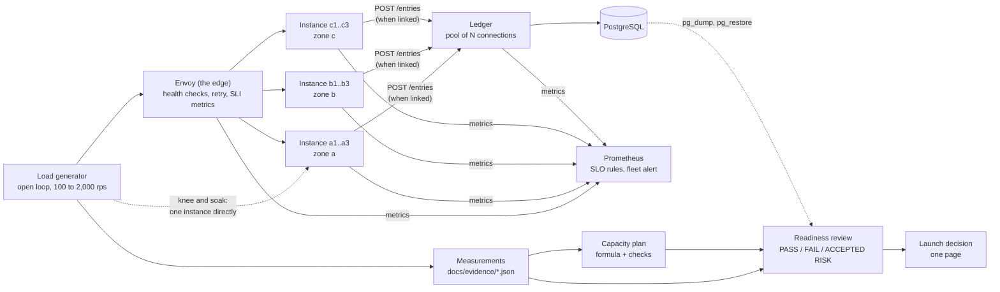

# Architecture: the capacity rig and the readiness review

This document describes what the code in this repository does and why it is shaped this way. Component names match the diagram in the lesson ("From a load-test knee to a launch decision"): **Load generator**, **One instance**, **Measurements**, **Capacity plan**, **Readiness review**, **Launch decision**. The repository adds what a real fleet has around them: a load balancer, zones, a shared dependency, a database and Prometheus.

## Components and what each owns

| Component (lesson name) | Where it lives | What it owns |
| --- | --- | --- |
| **Load generator** | [`infrastructure/openloop.py`](src/capacity/infrastructure/openloop.py), [`interfaces/loadtest_cli.py`](src/capacity/interfaces/loadtest_cli.py) | An open-loop HTTP/1.1 client: requests arrive on a fixed schedule, latency is measured from the scheduled arrival, and the generator reports its own lag. Runs inside the compose network. |
| **One instance** | [`interfaces/instance_app.py`](src/capacity/interfaces/instance_app.py), [`domain/cpu.py`](src/capacity/domain/cpu.py) | `GET /work`: real CPU work (a chain of SHA-256) on the event loop, then an optional call to the ledger. A container pinned to a vCPU of its own (`cpuset`) with 256 MiB. Its capacity is one over the cost of a request. |
| **Measurements** | [`application/loadtest.py`](src/capacity/application/loadtest.py), [`domain/latency.py`](src/capacity/domain/latency.py), `docs/evidence/*.json` | The stepped knee test (throughput, p50, p99, errors and the instance's CPU at each step), timed runs with per-window p99, and the JSON each experiment leaves behind. |
| **Capacity plan** | [`domain/knee.py`](src/capacity/domain/knee.py), [`domain/plan.py`](src/capacity/domain/plan.py), [`application/capacity_report.py`](src/capacity/application/capacity_report.py) | Finding the knee, choosing a load a margin below it, and the fleet formula with a lost-zone check; rendered to `docs/capacity-plan.md` from the evidence. |
| **Edge (Envoy)** | [`deploy/envoy.yaml`](deploy/envoy.yaml) | Round-robin over the nine instances the compose file defines (a1..a3, b1..b3, c1..c3) in three localities; the plan says how many run with active health checks, one retry on a refused connection, and the request counts and latency histogram the SLIs read. |
| **The shared ledger** | [`interfaces/ledger_app.py`](src/capacity/interfaces/ledger_app.py), [`sql/`](sql) | A bounded pool of PostgreSQL connections that every instance's request borrows for a configurable time. The next bottleneck. |
| **Readiness review** | [`application/readiness.py`](src/capacity/application/readiness.py), [`domain/readiness.py`](src/capacity/domain/readiness.py), `readiness/checklist.yaml` | A checklist where every item runs a check against the repository or the evidence and gets PASS, FAIL or ACCEPTED RISK with an owner; a FAIL has a date, an accepted risk the condition that reopens it. |
| **Launch decision** | [`application/launch_decision.py`](src/capacity/application/launch_decision.py), `docs/launch-decision.md` | One of LAUNCH, LAUNCH WITH CONDITIONS, DON'T LAUNCH YET, with every condition's owner and date on the same line. |
| **Experiments** | [`interfaces/experiments_cli.py`](src/capacity/interfaces/experiments_cli.py), [`infrastructure/compose.py`](src/capacity/infrastructure/compose.py) | The things that need containers stopped, paused, recreated and loaded: zone loss, pool sweep, frozen dependency, rolling restart, backup and restore. |
| **SLOs and alerts** | [`slo/`](slo) | Availability and p99-under-50-ms SLOs measured at Envoy, burn-rate alerts generated from them, and the fleet-capacity alert whose threshold is the plan's number. |

## Pattern: layers with ports and adapters

```text
interfaces      the instance, the ledger, the load test, the experiments, the plan and review commands
infrastructure  the open-loop client, aiohttp, psycopg_pool, docker compose, files, Prometheus metrics, settings
application     the knee test, the timed runs, the review, the renderers, and the ports they ask for
domain          the CPU work, percentiles, the knee, the safe load, the plan formula, review items and decisions
```

Dependencies point down only (import-linter in `make lint`); a second contract keeps `aiohttp`, `psycopg`, `psycopg_pool`, `yaml`, `prometheus_client` and `subprocess` out of domain and application. The knee test takes an `OpenLoopRunner` and a `CpuProbe` as ports, so its logic (stop two steps past the knee, choose the safe load) is tested against a fake service whose p99 jumps at a known rate; the review takes `ProjectFiles`, `EvidenceStore`, `SloCatalog` and `ChecklistConfig`, so every verdict is tested with the evidence present, absent and wrong.

## Data flow

Drawn versions of this figure and of the walk-through: [the architecture](docs/diagrams/architecture.svg) and [one run](docs/diagrams/flow.svg).



### One run, step by step (`make run`)

1. `make knee`: the generator steps one instance (no ledger yet) through 100, 200, ... requests a second for 10 seconds each. Before and after every step it reads the instance's `process_cpu_seconds_total`, so each step has a CPU utilization. `find_knee` takes the median p99 of the first three steps as the flat baseline and calls the first step more than three times that, or failing more than 1% of requests, the knee. The test stops two steps past it. The resource is named only if the instance was using at least 90% of its core there.
2. `make soak` holds the instance at `safe_load(knee)` (a quarter below the knee, rounded down to 25) and reports p99 in 10-second windows, so a slow drift cannot hide in an average.
3. `make plan` applies the formula to the measured safe load: `instances_for_peak = ceil(2,000 / safe)`, then the smallest total over three zones whose *largest zone* can be lost and still leave that many. The plan is saved as evidence.
4. `make full-fleet` and `make zone-loss` run 2,000 requests a second through Envoy against all the instances the plan names (eight in the run recorded in the README) and then against those that remain after `docker compose stop` of zone a (five for that plan), after waiting until Envoy's health checks agree on that number.
5. `make pool-sweep` links every instance to the ledger, then runs the projected peak against ledger pools of the naive size (peak times hold time) and upward. The smallest size that holds, plus 25%, is adopted and confirmed.
6. `make dependency-test` pauses the ledger (it accepts connections and never answers) and sends traffic to one instance: every request must fail within the ledger timeout plus 250 ms, and the instance's health endpoint must stay green.
7. `make rollout-test` recreates the instances one at a time to v2 and back to v1 while 1,000 requests a second flow through Envoy, waiting for every planned member (eight in the README's run) to be healthy after each, and checks that the version answering is the intended one at the end of each roll.
8. `make restore-test` dumps the ledger, restores the dump into a scratch database and compares row count and an order-independent checksum with the source, timing the restore against the target.
9. `make plan-doc` and `make review` render the capacity plan and run the checklist against everything above; the decision lands in `docs/launch-decision.md`.

## Decisions and trade-offs

The decision records are in [docs/adr](docs/adr):

- [0001](docs/adr/0001-open-loop-load-measured-from-the-scheduled-arrival.md): open-loop load, latency from the scheduled arrival, a self-checking generator.
- [0002](docs/adr/0002-envoy-as-the-edge.md): Envoy as the load balancer and the place the SLIs are measured.
- [0003](docs/adr/0003-one-core-per-instance-and-cpu-work-on-the-event-loop.md): one core per instance, real CPU work on the event loop.
- [0004](docs/adr/0004-the-shared-dependency-is-a-real-pool.md): the shared dependency is a real connection pool in front of PostgreSQL.

**Evidence is data, and tests read it.** Each experiment writes JSON under `docs/evidence/`; the plan, the runbooks, the alert threshold and the launch decision are checked against it by `tests/unit/test_evidence.py`. A plan that says "five instances" while the evidence says six fails the build. The cost is that evidence is committed measurement from one machine; the README says so. So far only `restore.json` and `dependency.json` are committed; the knee, soak, plan and pool-sweep results are "not yet measured" in the README, and the numbers in this document that depend on them (for example eight instances, five survivors) come from separate, uncommitted runs.

**The review can fail.** A check that cannot find its evidence fails (`restore not yet tested`), and no check passes on a file merely existing when the lesson asks for a measurement. Verdicts that are not PASS must name an owner (a role) and a date or a reopening condition, or the item cannot be constructed (`InvalidReviewError`).

**The plan is also an alert.** `FleetBelowPeakCapacity` fires when fewer than the plan's `instances_for_peak` instances are healthy; `FleetBelowFullStrength` when fewer than the plan's total are. A test reads both thresholds from the plan evidence.

**Latency is the edge's, availability too.** Envoy's `downstream_rq_time` histogram has no status label, so the latency SLO's valid events are all requests (the sibling `sre-slos-and-budget` project counts only successes). Both choices are stated where they are made.

**Stopping the event loop is on purpose.** CPU work runs on the loop, so past the knee the health endpoint queues behind requests. That is realistic, and the reason the fleet is sized to stay below the knee instead of surviving above it.

## Failure modes the lesson teaches and how the code shows them

| Failure | Where to see it |
| --- | --- |
| A closed-loop test that cannot show a queue | `tests/integration/test_instance_and_loadgen.py::test_latency_includes_the_time_a_request_waited_behind_a_busy_server` |
| A safe load right at the knee | `domain/knee.py::safe_load` and `tests/unit/test_knee_and_plan.py` (the margin is a stated parameter) |
| A short validation that hides drift | `domain/latency.py::window_p99s`, `make soak` reports every window |
| Headroom from today's peak | `tests/unit/test_knee_and_plan.py::test_headroom_comes_from_the_projected_peak_not_todays` |
| A plan never checked against a load test | `make zone-loss` and `test_step_three_the_planned_fleet_minus_a_zone_was_run_at_the_projected_peak_and_held` |
| A pool sized to the naive average | `make pool-sweep`: the pool of 20 is expected to fail the SLO at the projected peak (not yet measured here) |
| Passing "restore" without ever restoring | `Reviewer._restore_check`: no evidence is a FAIL; `make restore-test` actually restores and compares |
| A review that cannot fail | `tests/unit/test_readiness.py`: eleven ways to make an item fail |

## Limits of the teaching build against a production one

- Zones are labels on containers of one Docker host; real zones also fail together over networks and control planes.
- One Envoy, one ledger and one database: single points of failure the lesson does not ask to remove.
- Python on an event loop is a poor way to spend a core; the point is the method (knee, margin, formula, check), which transfers to any runtime.
- Measured numbers are from one laptop at a time; production numbers come from production-like hardware and a traffic mix.
- Steps and the soak are shortened by default.

## How to extend it

- **A different instance size:** change `cpus` and `mem_limit` in `docker-compose.yml` and rerun `make run`; compare the two plans.
- **Autoscaling:** add a controller that recreates instances from the Envoy member count and the in-flight gauge; test it with a step from half to full peak using `capacity-loadtest fleet`.
- **A new readiness check:** add a `Check` to `Reviewer.checks()`, an entry to `readiness/checklist.yaml`, and a test that makes it fail.
- **Real zones:** replace the compose services with instances in real zones and rerun `zone-loss` by shutting a zone's nodes down.
